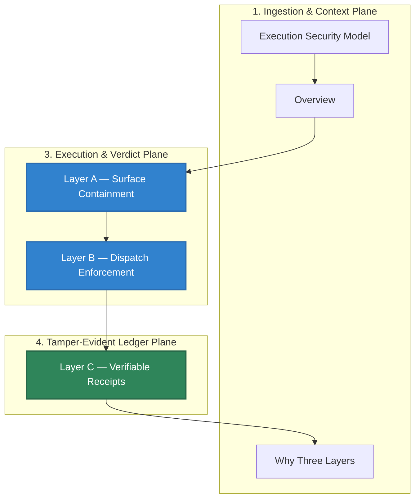

# Execution Security Model

<!-- quantum_posture: this page describes classical Ed25519 receipt and permit signing and adds no post-quantum cryptographic control. -->

## Audience

Security reviewers and runtime maintainers checking how HELM AI Kernel fails closed before dispatch.

## Outcome

After this page you should know what this surface is for, which source files own the behavior, which public route or adjacent page to use next, and which validation command to run before changing the claim.

## Source Truth

- Public route: `execution-security-model`
- Source document: `helm-ai-kernel/docs/EXECUTION_SECURITY_MODEL.md`
- Public manifest: `helm-ai-kernel/docs/public-docs.manifest.json`
- Source inventory: `helm-ai-kernel/docs/source-inventory.manifest.json`
- Validation: `make docs-coverage`, `make docs-truth`, and `npm run coverage:inventory` from `docs-platform`

Do not expand this page with unsupported product, SDK, deployment, compliance, or integration claims unless the inventory manifest points to code, schemas, tests, examples, or an owner doc that proves the claim.

## Troubleshooting

| Symptom | First check |
| --- | --- |
| Published output is stale or incomplete | Run `npm run helm-public:accuracy` in `docs-platform`, then check the source path and public manifest row for this page. |
| A claim needs implementation backing | Check the Source Truth files above and update the implementation, manifest, source inventory, or page in the same change. |

## Diagram

This scheme maps the main sections of Execution Security Model in reading order.




> **Canonical** · v1.0 · Normative
>
> This document defines HELM's three-layer execution security model.
> It is the canonical reference for how HELM reduces, enforces, and
> proves execution safety for AI agent tool calls.
>
> **Terminology**: follows the Unified Canonical Standard (UCS v1.3).

---

## Overview

HELM implements three independent, composable layers of execution security.
Each layer addresses a distinct class of threat and operates at a different
point in the execution lifecycle. No single layer is sufficient on its own.

## Guarantees And Non-Guarantees

HELM AI Kernel does:

- enforce deny-by-default policy at MCP and OpenAI-compatible dispatch boundaries;
- sign a receipt for every `ALLOW`, `DENY`, and `ESCALATE` decision that `serve` and `mcp serve` record (CTL-012); the standalone `proxy` hash-chains its receipts and signs them only when started with `--sign <seed>`;
- quarantine unknown MCP servers and tools (no shipped path approves them yet, so a quarantined server stays quarantined; CTL-025);
- produce offline-verifiable EvidencePacks for source-backed receipt material.

HELM AI Kernel does not:

- protect against a compromised host kernel, runtime, or operator account;
- make reads safe when policy already allows the agent to read sensitive files;
- replace secret scanning, network firewalls, endpoint controls, or OS sandboxing;
- prevent prompt injection at generation time; enforcement happens at dispatch;
- capture side effects from tools that bypass the HELM proxy or MCP boundary;
- certify every MCP tool schema through static analysis;
- certify compliance with a regulatory standard by itself.

```
                ┌─────────────────────────────────────────┐
                │        Agent / Orchestrator              │
                └──────────────────┬──────────────────────┘
                                   │
          ┌────────────────────────▼────────────────────────┐
          │  Layer A — Surface Containment (design-time)    │
          │  Reduces WHAT can be called                     │
          │  capability manifests · policy packs · mandates │
          │  effect classes · destination scoping           │
          └────────────────────────┬────────────────────────┘
                                   │
          ┌────────────────────────▼────────────────────────┐
          │  Layer B — Dispatch Enforcement (dispatch-time)  │
          │  Gates EACH call at PEP boundary                │
          │  schema PEP · result contracts                  │
          │  PDP/CPI verdict · deny-by-default              │
          └────────────────────────┬────────────────────────┘
                                   │
          ┌────────────────────────▼────────────────────────┐
          │  Layer C — Verifiable Receipts (post-execution)  │
          │  Proves WHAT happened                           │
          │  Ed25519 receipts · ProofGraph DAG · hash chain │
          │  EvidencePack · offline verification             │
          └─────────────────────────────────────────────────┘
                                   │
                                   ▼
                            Tools / Systems
```

---

## Layer A — Surface Containment

**When**: Design-time / configuration-time.
**Purpose**: Structural attack surface reduction. Shrink what can be called
before any runtime evaluation begins.

Surface containment is a **design-time property** — it is configured before
execution, not computed per-call. It defines the **bounded execution surface**:
the maximum possible set of tools, destinations, and side-effect classes that
an agent can reach.

### Mechanisms

| Mechanism | Description |
| :--- | :--- |
| **Capability manifests** | The kernel MCP server serves a fixed tool catalog and lists it at `/mcp/v1/capabilities`. `helm-gateway` lists to an agent only the effect types of its live mandates (CTL-057) |
| **Policy packs** | A serve policy file names one reference pack. The pack's `runtime_actions` are the actions `serve`, `proxy --policy` and `mcp serve --policy` can allow from that file; an action with no policy is denied (CTL-001) |
| **Side-effect classes** | Each MCP catalog tool and kernel effect type carries an effect class, `E0` to `E4`, and `plan` maps the class of a plan step to a backend and profile label. `helm-gateway` resolves a risk class per effect and escalates a high-risk one for approval (CTL-052) |
| **Mandates** | `helm-gateway` admits an effect only under a live mandate of the caller's principal that names the effect type (CTL-052), and mints a GitHub credential only for a repository the tenant's installation entry allows (CTL-051) |
| **Destination scoping** | The Guardian in `serve`, `proxy` and `mcp serve` denies every evaluation that names an egress destination; no configuration adds an allowlist (CTL-047). The egress proxy of a Launchpad local container denies destinations outside its catalog entry (CTL-033) |
| **Filesystem/network deny-by-default** | Sandbox grants declare deny-by-default I/O. Records only: the kernel runs no pack and has no sandbox runtime (`controls.yaml` CTL-044, retired) |
| **Sandbox profiles** | `sandbox profiles` and `sandbox grant` list and seal backend profiles as records, and `sandbox exec` refuses every request. `helm-gateway` runs `sandbox.create`, `sandbox.exec` and `sandbox.terminate` through the provider an operator configures (CTL-062) |

### Architectural Property

Surface containment reduces the **blast radius** of any exploitation.
Even if dispatch enforcement (Layer B) has a bug, the bounded surface
limits what an attacker can reach. This is defense in depth by construction,
not by runtime checking.

### Implementation References

| Component | Package |
| :--- | :--- |
| Sandbox isolation (library; the shipped server runs no pack) | `core/pkg/runtime/sandbox/` |
| Tool catalog / MCP gateway | `core/pkg/mcp/` |
| Manifest validation | `core/pkg/manifest/` |

---

## Layer B — Dispatch Enforcement

**When**: Dispatch-time (per-call).
**Purpose**: Runtime per-call admissibility. Every tool call passes through a
fail-closed policy gate that evaluates **execution admissibility** — the
determination that a specific call, with specific args, at a specific time,
under a specific policy stack, is permitted.

Dispatch enforcement is a **dispatch-time property** — it is computed for
every individual call. No call routed through a HELM adapter, proxy, hook or
MCP route reaches an executor without a signed `DecisionRecord`; calls that
never cross HELM are not governed (INV-024).

### Mechanisms

| Mechanism | Description |
| :--- | :--- |
| **Schema PEP** | JCS canonicalization + SHA-256, fail-closed on input schema mismatch for MCP tool calls (CTL-010, CTL-025); the OpenAI-compatible proxy only requires parseable tool arguments |
| **PDP/CPI evaluation** | Canonical Policy Index resolves P0 → P1 → P2 → verdict |
| **Budget enforcement** | Not a Guardian gate: the draw-down gate had no shipped installer and was removed (CTL-011, retired). The kernel bridge denies a breached ceiling (`BUDGET_EXCEEDED`) or an unavailable enforcer (`BUDGET_ERROR`) only when constructed with a budget enforcer, which the shipped proxy is not |
| **Contract pinning** | The connector output validator had no caller and was removed (CTL-045, retired), so no shipped validator reports drift from a pinned response schema. `helm-gateway` checks each established observation against the effect type's result contract (`admission.typedResult`: a fixed typed result, or a declared schema where an adapter declares one) and leaves a violating attempt `UNKNOWN`. The GitHub adapter in `helm-gateway`, the only shipped adapter that reports it, checks provider answers against its typed results and returns `ERR_CONNECTOR_CONTRACT_DRIFT` on a mismatch: before its write the dispatch is not sent, and after it the dispatch stays indefinite until reconciliation reads the provider back |
| **PRG evaluation** | Proof Requirement Graph checks cryptographic prerequisites |
| **Deny-by-default** | An action with no policy → `NO_POLICY_DEFINED`. A policy that cannot be evaluated → `PRG_EVALUATION_ERROR` (CTL-001, INV-005) |
| **Delegation session gate** | A request that names a `delegation_session_id` is denied with `DELEGATION_INVALID`. The shipped binaries wire an empty delegation store that nothing writes, so the checks of a session's capabilities, scope and principal against its delegator never run on a real session (CTL-034, observed-only) |
| **Threat scan** | TCB scanner denies untrusted input with high-risk findings → `PROMPT_INJECTION_DETECTED`, `TAINTED_INPUT_HIGH_RISK_DENY` and related codes (CTL-019) |

Hardware-backed attestation and zero-knowledge execution research are not
current public enforcement claims. Do not describe those paths as active until a
tagged release ships the matching code, tests, verifier evidence, and release
artifacts.

### Architectural Property

**Runtime execution enforcement** provides per-call guarantees:
every call is individually evaluated, every verdict is signed, every
denial is recorded. This is the choke point — the single enforcement
boundary that separates intent from effect.

### Key Term: Execution Admissibility

**Execution admissibility** is the canonical term for the PEP/CPI
determination that a specific tool call is permitted:

    Admissible iff:
      (1) tool ∈ declared surface (Layer A)
      (2) args conform to the tool's declared schema
      (3) budget sufficient (not checked by a shipped binary; CTL-011)
      (4) PRG requirements satisfied
      (5) identity authorized for resource boundary
      (6) no delegation session named (one always fails; CTL-034)
      (7) no threat signals detected
      (8) all P0 ceilings respected

If any condition fails, the call is **inadmissible** and produces a
signed `DENY` verdict with a deterministic reason code.

### Implementation References

| Component | Package |
| :--- | :--- |
| Guardian (PEP) | `core/pkg/guardian/` |
| Policy contracts | `core/pkg/contracts/` |
| Gated execution | `core/pkg/guardian/` (the standalone SafeExecutor in `core/pkg/executor/` was removed: no shipped caller) |
| Canonicalization | `core/pkg/canonicalize/` |

---

## Layer C — Verifiable Receipts

**When**: Post-execution.
**Purpose**: Post-hoc verifiability. Every execution — allowed or denied —
produces cryptographic evidence that can be independently verified without
network access.

Verifiable receipts provide **offline-verifiable proof** that the execution
boundary operated correctly.

### Mechanisms

| Mechanism | Description |
| :--- | :--- |
| **Ed25519 signed receipts** | `serve` and `mcp serve` sign a `receipt.v5` record for every verdict they persist: ALLOW, DENY and ESCALATE (CTL-012). The standalone `proxy` signs its receipts only when started with `--sign <seed>`; without it they are hash-chained and unsigned, and the key that signs the Guardian's decision records lasts only as long as the process |
| **ProofGraph DAG** | Append-only directed acyclic graph with Lamport causal ordering (`core/pkg/proofgraph`). `proxy` persists one as `proofgraph.json`. The `/api/v1/proofgraph/*` routes on `serve` return the per-session receipt chain, not a graph |
| **Causal hash chain** | The signed fields of a receipt include `prev_hash`, the canonical SHA-256 of the previous receipt in its session, and its Lamport clock |
| **EvidencePack** | Deterministic `.tar` export — same inputs produce identical output bytes |
| **Merkle condensation** | Risk-tiered checkpoints; low-risk receipts replaceable by inclusion proofs. Not wired: the condenser has no shipped caller |
| **Offline verification** | `helm-ai-kernel verify`, `verify receipt` and the standalone `receipt_verify` re-check signatures, hashes and chain links from the files alone. `verify` contacts a network service only with `--online`, or to look up a Rekor anchor under the `customer` and `high-assurance` profiles. `replay` serves the recorded tape of a pack that carries one back through the tape replayer and checks each entry against its recorded hash and the tape manifest; no shipped command records tapes or re-executes a run |
| **Deny receipts** | A denied call gets a receipt with its reason code, signed wherever receipts are signed (first row) — not just silently dropped |

### Architectural Property

The receipts layer is **independent of enforcement**. Even if enforcement
logic changes (Layer B), the receipt chain proves what actually happened.
This separation is critical: enforcement can err, but errors are always
visible in the receipt chain.

### Implementation References

| Component | Package |
| :--- | :--- |
| ProofGraph DAG | `core/pkg/proofgraph/` |
| Cryptographic signing | `core/pkg/crypto/` |
| Evidence export/verify | `core/pkg/evidence/` |

---

## Why Three Layers

A single layer is insufficient:

| Single-Layer Approach | Failure Mode |
| :--- | :--- |
| Surface containment only | Correct tools can still be called with malicious args |
| Dispatch enforcement only | Correct enforcement with too-large surface = high blast radius |
| Receipts only | You see what happened after the damage is done |

The three-layer model provides **defense in depth by construction**:

1. **Layer A** reduces the maximum possible attack surface
2. **Layer B** gates every individual call at the choke point
3. **Layer C** provides independent proof of correct operation

Each layer protects against failures in the other two.

---

## Canonical Vocabulary

| Term | Layer | Definition |
| :--- | :--- | :--- |
| **Bounded surface** | A | The maximum set of reachable tools/destinations. Design-time property |
| **Surface containment** | A | The act of constraining the bounded surface |
| **Runtime execution enforcement** | B | Per-call policy evaluation and verdict issuance |
| **Execution admissibility** | B | The determination that a specific call is permitted |
| **Verifiable receipts** | C | Cryptographic evidence of execution decisions |
| **Execution authority** | All | The composite property: containment + enforcement + proof |

---

## Conformance Mapping

`helm-ai-kernel conform` runs one gate, G0 (build identity), which tests no
layer of this model; gates G1–G15 and GX were retired
([CONFORMANCE.md](CONFORMANCE.md)). The checks that exercise the layers are:

| Check | Layer |
| :--- | :--- |
| `controls.yaml` entries with status `enforced`, whose tests `make controls-check` runs | A, B and C, one control at a time |
| Bound negative vectors (`go test ./pkg/conformance/negative`, in `core`) | B |
| `helm-ai-kernel verify` over an EvidencePack (CTL-009) | C |

---

## Normative References

| Document | Relevance |
| :--- | :--- |
| [ARCHITECTURE.md](ARCHITECTURE.md) | System-level model |
| [core/pkg/store](../core/pkg/store/) | Receipt store and causal hash chain |
| [OWASP_MCP_THREAT_MAPPING.md](OWASP_MCP_THREAT_MAPPING.md) | OWASP MCP alignment |
| [core/pkg/manifest](../core/pkg/manifest/) | Tool argument validation (schema PEP) |
| [CONFORMANCE.md](CONFORMANCE.md) | What `conform` runs, and the retired levels |

_Canonical revision: 2026-05-21 · HELM UCS v1.5_
