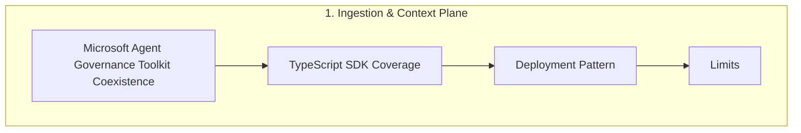

# Microsoft Agent Governance Toolkit Coexistence

## Audience

Integration developers mapping Microsoft agent tooling through the HELM OpenAI-compatible proxy and receipt flow.

## Outcome

After this page you should know what this surface is for, which source files own the behavior, which public route or adjacent page to use next, and which validation command to run before changing the claim.

## Source Truth

- Public route: `integrations/microsoft-agent-governance-toolkit`
- Source document: `helm-ai-kernel/docs/INTEGRATIONS/microsoft_agent_governance_toolkit.md`
- Public manifest: `helm-ai-kernel/docs/public-docs.manifest.json`
- Source inventory: `helm-ai-kernel/docs/source-inventory.manifest.json`
- Validation: `make docs-coverage`, `make docs-truth`, and `npm run coverage:inventory` from `docs-platform`

Do not expand this page with unsupported product, SDK, deployment, compliance, or integration claims unless the inventory manifest points to code, schemas, tests, examples, or an owner doc that proves the claim.

## Troubleshooting

| Symptom | First check |
| --- | --- |
| Published output is stale or incomplete | Run `npm run helm-public:accuracy` in `docs-platform`, then check the source path and public manifest row for this page. |
| A claim needs implementation backing | Check the Source Truth files above and update the implementation, manifest, source inventory, or page in the same change. |

## Diagram

This scheme maps the main sections of Microsoft Agent Governance Toolkit Coexistence in reading order.

Microsoft announced Agent Governance Toolkit (AGT) on 2026-04-02 as an open-source runtime governance layer for autonomous AI agents. The announcement and repository position AGT around deterministic action policy, zero-trust identity, sandboxing, SRE controls, and framework integrations across LangGraph, CrewAI, OpenAI Agents SDK, PydanticAI, LlamaIndex, and adjacent agent stacks.

HELM should not replace AGT in a customer environment that has already standardized on it. The narrow integration stance is:

- AGT can remain the framework-local governance layer.
- HELM sits below it as the non-bypassable, receipt-bearing boundary for tool execution.
- HELM evidence packs remain the audit artifact when execution must be replayed or independently verified.

## TypeScript SDK Coverage

Route a framework's side-effecting tool call to the HELM effect gateway with the
TypeScript SDK's `NativeGatewayClient`: it sends the exact tool name, arguments
and target to the gateway, which decides, dispatches and records the attempt
(see [Framework Adapters](framework-adapters.md)). The SDK no longer ships
per-framework chat-completion helpers; they never evaluated the tool itself.

## Deployment Pattern

Run the framework agent exactly where it already runs. Configure AGT or framework-local middleware first. Before any side-effecting tool executes, send it through the HELM effect gateway with `NativeGatewayClient` instead of executing it directly.

For OpenAI-compatible stacks, the HELM proxy base URL governs the model request; it does not govern tool calls, which go through the gateway.

## Limits

This is coexistence guidance, not Microsoft certification. HELM does not import AGT packages, modify AGT policies or validate AGT evidence files.

Primary sources verified on 2026-04-30:

- Microsoft Open Source Blog: <https://opensource.microsoft.com/blog/2026/04/02/introducing-the-agent-governance-toolkit-open-source-runtime-security-for-ai-agents/>
- Microsoft AGT repository: <https://github.com/microsoft/agent-governance-toolkit>
- Microsoft AGT releases: <https://github.com/microsoft/agent-governance-toolkit/releases>
