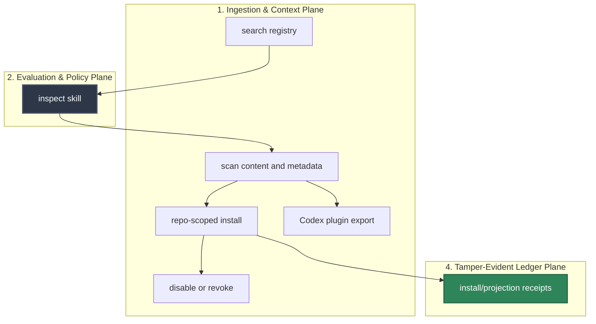

# HELM Skill Packs Flow Catalog

<!-- quantum_posture: first-party skill packs are pinned by SHA-256 content digests compiled into the binary; this page names the release's existing cosign bundle and adds no signature scheme and no post-quantum cryptographic control. -->

HELM Skill Packs are scoped procedural packages for agents. A skill can guide behavior, but it cannot grant tool permissions or execution authority.

Skill Packs are not signed. HELM has no publisher signature format or publisher key for them. The only packs the CLI allows are the first-party packs under `registry/skills/helm/`, and only when their files are byte-for-byte the ones the binary was built with.

## Audience

This page is for developers and reviewers evaluating HELM-managed skill
installation, projection, disable, revoke, and marketplace flows.

## Outcome

You should leave with the command sequence for each skill-pack flow and the
authority boundary that keeps skills from granting tools or execution rights.

## Source Truth

- Skill runtime commands: `core/cmd/helm-ai-kernel/skills_cmd.go`
- Skill runtime packages: `core/pkg/skillpacks/`
- Skill registry: `registry/skills/`
- First-party manifest compiled into the binary: `core/pkg/skillpacks/first_party_manifest.json`
- Kernel skill policy: `policies/skills/first-party.safe.toml`
- Skill docs: `docs/skills/`

## What Verification Proves

Everything in `skillpack.json` is written by the pack's author: `publisher`, `status`, `signature_ref`, `publisher_key_ref`, `content_hash` and `policy_ref`. None of it can say who published the pack, so the scan reads none of it as proof.

`core/pkg/skillpacks/first_party_manifest.json` is compiled into the binary. For each pack under `registry/skills/helm/` it holds the id, the version and a content digest: the SHA-256 of the canonical list of every file's path, SHA-256 and size. `go test ./pkg/skillpacks` fails when that file and the registry differ. A scan reads the pack directory once, without following a link out of it, computes the same digest and reports one of these publisher states:

| `publisher_verification.state` | Meaning | Verdict | Exit code |
| --- | --- | --- | --- |
| `first_party` | Every file hashes to the digest the binary pins for this id and version. | `ALLOW`, unless another check objects | 0 |
| `first_party_mismatch` | The binary pins this id and version, and the files differ or cannot all be hashed. The reason names the files. | `DENY` | 1 |
| `unsigned` | The pack is not in the manifest. Nothing was verified, and nothing could be: there is no signature to check. | `DENY` when the manifest declares `status: verified`, otherwise `ESCALATE` | 1 |

`first_party` means the pack is the one in the source tree the running binary was built from. It is a digest comparison, and no signature is checked at that point. It is worth as much as the binary: a release binary carries a keyless cosign bundle and build provenance that are verified when the binary is installed (`docs/VERIFICATION.md`), and a binary built from a changed tree pins that tree's packs. A binary does not vouch for a different version of a pack than the one it was built with.

The verdict is reached under rules compiled into the binary. `policies/skills/first-party.safe.toml` is the written statement of those rules, a test binds each of its keys to what the code does, and its SHA-256 is the `policy_hash` in scan results and receipts. No policy file is read at scan time. A pack's `policy_ref`, and any policy file beside the pack, changes nothing.

## OSS Flows

### Search

`helm-ai-kernel skills search --json`

Lists the packs in `registry/skills/` of the repository the working directory is in. That registry is whatever the checkout holds, so each entry carries the manifest and the `publisher_verification` computed for it. The text output shows the computed state, never the status a manifest declares.

### Inspect

`helm-ai-kernel skills inspect helm/repo-auditor --json`

Shows the manifest, the computed `publisher_verification`, requested projections, and the authority boundary: this skill does not grant tool permissions.

### Verify And Scan

`helm-ai-kernel skills verify <path_or_ref> --json`

`helm-ai-kernel skills scan <path_or_ref> --json`

The two names run the same check. It computes `skill_content_hash` and the pack content digest, decides the publisher state, scans `SKILL.md`, metadata, every bundled file, symlinks and MCP/tool requests, flags instructions that run commands or fetch from outside the pack, and emits `SKILL_SCAN_ATTESTATION`. The command exits 0 only for `ALLOW`; `ESCALATE` and `DENY` exit 1 in text and JSON output alike.

### Repo-Scoped Install

`helm-ai-kernel skills install helm/repo-auditor --agent codex --scope repo`

Runs the scan and installs only an `ALLOW` pack whose publisher state is `first_party`. It then writes managed projection files atomically inside the repo root without following symlinks, and emits `SKILL_INSTALL_RECEIPT` plus `SKILL_PROJECTION_RECEIPT`. The install record in `.helm/skillpacks/installed.json` stores the publisher state the scan found. Any other pack is blocked and nothing is written; there is no approval path for an unsigned pack.

### User Or Global Install

`helm-ai-kernel skills install helm/repo-auditor --agent codex --scope user`

Returns `ESCALATE` by default and writes no projection files.

### Export Codex Plugin

`helm-ai-kernel skills export helm/repo-auditor --format codex-plugin --output ./dist/repo-auditor`

Writes `.codex-plugin/plugin.json`, bundled skill files, pending/quarantined MCP metadata, and off-by-default hooks.

Export refuses a `DENY` scan and proceeds on `ESCALATE`, so it packages unsigned packs. The export receipt carries the scan's verdict, and `plugin.json` records `helm_scan_verdict` and `helm_publisher_verification`. Those two fields travel inside the plugin, so they are a record of the export scan and not proof to whoever receives the plugin.

### Marketplace

`helm-ai-kernel skills marketplace init --scope repo`

Creates `.agents/plugins/marketplace.json`.

`helm-ai-kernel skills marketplace add <plugin_path>`

Adds only plugins inside the repo root and records policy/source hashes with status `recorded`. It does not scan the plugin.

### Disable And Revoke

`helm-ai-kernel skills disable <skill_ref>`

Marks a HELM-managed install disabled and emits `SKILL_DISABLE_RECEIPT`.

`helm-ai-kernel skills revoke <skill_ref>`

Removes managed projection files, updates install state, and emits `SKILL_REVOKE_RECEIPT`. It removes only the canonical projection path under the repo root, and only while that file holds the content hash recorded at install; any other path listed in `installed.json` fails closed.

## Negative Flows

- Policy bypass attempt -> `DENY`.
- Secret exfiltration attempt -> `DENY`.
- Global install request -> `ESCALATE`.
- MCP side-effect auto-enable -> `ESCALATE`.
- Plugin hook auto-approval -> `DENY`.
- Symlink escape -> `DENY`.
- Pack that copies a first-party manifest's publisher, status, `signature_ref`, key ref and content hash -> `DENY` (`ERR_SKILL_VERIFIED_CLAIM_UNPROVEN`).
- First-party pack with an edited, added or removed file -> `DENY` (`ERR_SKILL_FIRST_PARTY_DIGEST_MISMATCH`).
- Unsigned pack that declares no verified status -> `ESCALATE` (`ERR_SKILL_SIGNATURE_UNVERIFIED`); it does not install.
- Instructions that run commands or fetch from outside the pack, such as a download piped into a shell -> `ESCALATE`, in a first-party pack too.
- Symlink on a managed install or revoke path -> the command fails closed.
- Opaque binary payload, a file over 1 MiB, more than 1024 files or more than 16 MiB in one pack -> `DENY`; the scan does not partly inspect a pack.

## Completion Gaps

Not built: publisher signatures. A pack from anyone other than this repository cannot be verified or installed until HELM has a signing format for packs, a publisher key and a place for an operator to state which publishers to trust. The first-party packs are not in the release binary either: the binary holds their digests, and the files come from a checkout.

`skills export` and `skills marketplace add` do not require an `ALLOW` scan. `marketplace add` records a plugin's path and hashes with status `recorded`; it runs no scan.

Deferred: full plugin marketplace e2e and Enterprise global rollout approvals remain outside this MVP slice.

## Troubleshooting

| Condition | Response |
| --- | --- |
| Scan returns `DENY` | Inspect the attestation and remove unsafe file, symlink, or payload content before install. |
| A first-party pack reports `first_party_mismatch` | The checkout's pack is not the one the binary was built with. The reason names the files; restore them, or build the binary from this checkout. |
| A pack reports `unsigned` | Expected for every pack outside `registry/skills/helm/`. It cannot be installed with this CLI. |
| `go test ./pkg/skillpacks` fails on the first-party manifest | A registry pack or the kernel skill policy changed. Regenerate with `UPDATE_SKILLPACK_FIRST_PARTY_MANIFEST=1 go test ./pkg/skillpacks -run TestFirstPartyManifestMatchesTheRegistry` from `core/` and review the diff. |
| User/global install escalates | Keep the install repo-scoped unless an operator approves the wider projection. |
| Marketplace add fails | Confirm the plugin path stays inside the repo root and has stable source hashes. |
| Revoke leaves files | Compare projection receipt paths with the working tree and remove only HELM-managed projections. |
