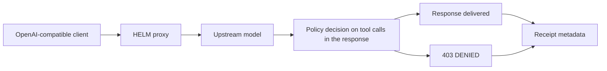

# OpenAI-Compatible Execution Boundary

If your applications already speak the OpenAI chat-completions API, you can put a policy boundary in front of them without changing a line of client code. HELM AI Kernel ships a proxy that accepts OpenAI-compatible requests, forwards them to the upstream model, and decides every tool call in the response against your policy before the client sees it.

Tool calls that policy does not allow never reach your client: the response comes back as `403` with `X-Helm-Status: DENIED` instead, and the decision is recorded as a hash-chained receipt either way. Receipts are signed only when the proxy starts with `--sign <seed>`; `make proxy` and the demo script do not pass it. The request itself does reach the provider. Allowed traffic flows through with receipt metadata attached, so every governed response in your fleet is attributable to a receipt.

Start it with one command (`make proxy` in the repository, or the demo script below), point your existing client's base URL at it, and watch the receipt stream record what your agents actually ask for.

## Gateway Policy Path



```bash
git clone https://github.com/Mindburn-Labs/helm-ai-kernel.git
cd helm-ai-kernel
make build
bash scripts/launch/demo-openai-proxy.sh
```

## Source Truth

- [Quickstart](../QUICKSTART.md)
- [Execution security model](../EXECUTION_SECURITY_MODEL.md)
- [MCP integration](../INTEGRATIONS/mcp.md)
- [Verification](../VERIFICATION.md)
