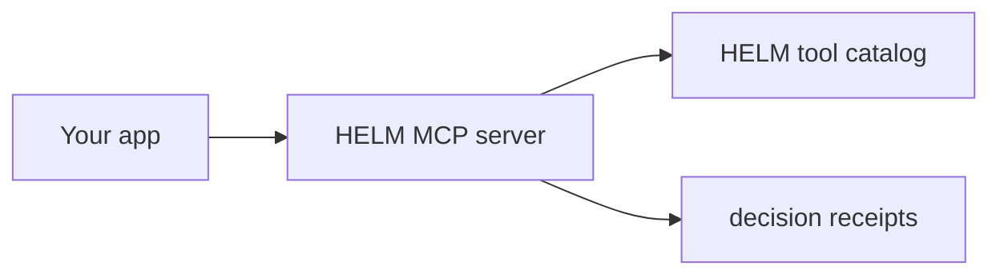

# OpenAI Starter — HELM AI Kernel Governed AI

Get started with HELM AI Kernel governance over OpenAI models in under 5 minutes.

## Prerequisites

- The Go version pinned in `go.work`
- `helm-ai-kernel` binary (run `make build` from repo root)

## Quick Start

```bash
# 1. Initialize a new HELM project with the OpenAI profile
helm-ai-kernel init openai ./my-openai-project

# 2. Run the doctor to inspect the setup
cd my-openai-project
helm-ai-kernel doctor

# 3. Start the governed MCP server on the port the script expects
helm-ai-kernel mcp serve --transport http --port 8080

# 4. From the repository root, in another terminal, open an MCP session
bash examples/starters/openai/first-governed-call.sh
```

The MCP server serves HELM's own tool catalog and does not call OpenAI, so no
API key is needed. `first-governed-call.sh` initializes an MCP session and
lists the tools; it does not call a tool and writes no receipt.

## What's Included

| File | Purpose |
| --- | --- |
| `helm.yaml` | Example HELM config shape for the OpenAI profile |
| `first-governed-call.sh` | Runnable script that opens an MCP session and lists the tools |
| `ci-smoke.sh` | CI-compatible smoke test |

## How It Works



A `tools/call` to the MCP server is decided by the Guardian before the tool
runs. Without `--policy <serve policy file>` every call is denied. The server
does not forward requests to OpenAI. To put HELM in front of OpenAI-shaped
traffic, use `helm-ai-kernel proxy`
([OpenAI proxy](../../../docs/INTEGRATIONS/openai_baseurl.md)).
